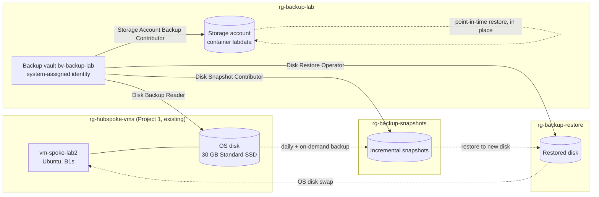

# Azure Backup and Recovery Lab

Backup **and proven restore** for two workloads: an Azure VM's OS disk (Azure Disk Backup, restored and swapped back in) and blob data (operational backup, point-in-time restore). Recovery objectives were defined before testing, data loss was simulated, every restore was verified by **SHA-256 checksum**, and recovery time was **measured**. Results, including two failures and their root causes, are reported as they happened.

Built as a hands-on project while studying for **AZ-104: Microsoft Azure Administrator**. This is lab work in a personal subscription, not a production environment.

> **Status:** Complete. Teardown is done except the empty Backup vault, which can't be deleted until its soft-deleted item is purged on **2026-11-15 21:45 UTC** (see [Teardown](#teardown)).

## Results at a Glance

| Test | Data verified | RTO measured | Target | Result |
|---|---|---|---|---|
| Disk restore, attempt 1 | ❌ restored disk re-damaged on first boot | 10:38 | ≤ 30:00 | **FAIL**, see [RCA-001](docs/rca/rca-001-run-command-replay.md) |
| Disk restore, attempt 2 | ✅ both hashes match | **10:23** | ≤ 30:00 | **PASS** |
| Blob point-in-time restore | ✅ overwritten and deleted blobs restored, control blob unchanged | **26:27** | ≤ 15:00 | **FAIL**, see [RCA-002](docs/rca/rca-002-blob-rto-target.md) |

**RPO (Recovery Point Objective):** disk backups run daily, so the worst case is just under 24 h. In the test, the on-demand recovery point was 5½ minutes before the incident. Blob operational backup is continuous: any second inside the 7-day window can be restored.

## Business Problem

A backup is only proven by a **restore**. Teams often discover during an incident that a backup was incomplete, unrestorable, or far slower to restore than assumed. This lab tests that assumption end to end: define the objectives, back up, destroy data on purpose, restore, prove the data is the right data, and time it.

It completes the operations story across this portfolio: Project 2 (Azure Monitoring and Incident Response) detects incidents, Project 3 (Azure Bicep CI/CD Pipeline) prevents bad changes, and this project recovers when something is lost anyway.

## Architecture



| Resource group | Contents | Vault identity's role (least privilege) |
|---|---|---|
| `rg-backup-lab` | Backup vault, blob storage account | Storage Account Backup Contributor on **the storage account only** |
| `rg-hubspoke-vms` (Project 1) | Source VM and disk | Disk Backup Reader on **the one disk only** |
| `rg-backup-snapshots` | Snapshots taken by Disk Backup | Disk Snapshot Contributor on this RG |
| `rg-backup-restore` | Disks restored from recovery points | Disk Restore Operator on this RG |

These are the roles Microsoft documents for each operation ("Use only the role definitions provided in the documentation"). Nothing was assigned at subscription scope. My own account received **Storage Blob Data Contributor** on the storage account only, so uploads and downloads used Entra ID sign-in (`--auth-mode login`) and never account keys.

## Design Decisions

| Decision | Alternative | Why |
|---|---|---|
| **Backup vault**, operational tier (Disk Backup + operational blob backup) | VM backup in a Recovery Services vault | VM backup carries a $10/month protected-instance fee (Azure Retail Prices API, East US). The operational tier has no protected-instance fee and no vault storage charge; snapshots bill at standard rates. Target lab cost under $1. |
| Restore to a **new disk** and **swap the OS disk** | Restore in place | Disk Backup doesn't support original-location restore. Keeping the original disk detached also made rollback trivial. |
| Snapshots and restores in **separate resource groups** | Everything in one RG | The vault's identity gets write access only where backups and restores land, and the budget can filter by RG. |
| Budget filtered by **resource group** | Filter by tag | Snapshots created by Azure Backup don't inherit our tags. |
| Vault and policies **built in the portal, then codified** in Bicep from exported state | Bicep first | Learn the settings, then prove the code matches what Azure stores: `what-if` reported **3 no change** ([m1-04](docs/evidence/m1-04-vault-bicep-whatif.txt)). |
| Blob policy created from an **explicit operational-only definition** | Portal or default template | The portal wouldn't allow unchecking the paid vaulted tier, and the CLI default template is vaulted too ([m1-02](docs/evidence/m1-02-backup-policies.txt)). |
| Verification by **SHA-256** of known data with a random nonce | "Job succeeded" | A completed job proves nothing about the data. Attempt 1 is the proof: the job succeeded, and the data was wrong. |

## Repository Structure

```
.
├── infra/
│   ├── budget.bicep                   # $5 monthly budget on the lab RGs (subscription scope)
│   ├── budget.example.bicepparam      # copy to budget.local.bicepparam (gitignored) with your email
│   └── vault.bicep                    # Backup vault + disk and blob policies
├── docs/
│   ├── plan.md                        # approved plan, milestones, cost, safety, outcomes
│   ├── evidence/                      # sanitized command output for every milestone (m0-01 ... m5-02)
│   ├── rca/
│   │   ├── rca-001-run-command-replay.md
│   │   └── rca-002-blob-rto-target.md
│   └── interview-guide.md
├── bicepconfig.json                   # linter rules raised to errors
└── .gitignore                         # excludes *.local.bicepparam, infra/export/, testdata/
```

## Prerequisites

- An Azure subscription where you can create resources and role assignments (Owner, or Contributor + User Access Administrator)
- Azure CLI with the `dataprotection` extension (tested with CLI 2.90.0 and extension 1.14.0), Bicep 0.48+, PowerShell 7
- An existing Linux VM to protect. This lab used Project 1's `vm-spoke-lab2`.

## How to Reproduce

1. **Resource groups and budget** (M0)
   ```powershell
   az group create -n rg-backup-lab -l eastus
   az group create -n rg-backup-snapshots -l eastus
   az group create -n rg-backup-restore -l eastus
   Copy-Item infra\budget.example.bicepparam infra\budget.local.bicepparam   # then set your email
   az deployment sub what-if -l eastus -f infra\budget.bicep -p infra\budget.local.bicepparam
   az deployment sub create  -l eastus -f infra\budget.bicep -p infra\budget.local.bicepparam
   ```
2. **Vault and policies** (M1): `az deployment group create -g rg-backup-lab -f infra\vault.bicep`
3. **Vault identity roles** (M1): assign the three disk roles at the scopes in the architecture table, using `--assignee-object-id` with `--assignee-principal-type ServicePrincipal`. Result: [m1-03](docs/evidence/m1-03-vault-identity-roles.txt).
4. **Disk backup** (M2): write test data and record its hashes, deallocate the VM, configure backup with `pol-disk-daily` and snapshot RG `rg-backup-snapshots`, then **Backup now** ([m2-01](docs/evidence/m2-01-marker-baseline.txt), [m2-02](docs/evidence/m2-02-disk-backup.txt)).
5. **Disk restore** (M3): restore the recovery point to a new disk in `rg-backup-restore`, run `az vm update --os-disk <restored disk id>`, start the VM, and verify the hashes. **Read [RCA-001](docs/rca/rca-001-run-command-replay.md) first.**
6. **Blob backup and restore** (M4): create a storage account with hierarchical namespace **off**, assign the storage role to the vault and a data role to yourself, configure backup with `pol-blob-operational`, then run a point-in-time restore ([m4-01](docs/evidence/m4-01-storage-and-roles.txt) to [m4-04](docs/evidence/m4-04-incident-restore.txt)).

## Security

- **Least privilege:** four narrow roles for the vault identity, each at a single resource or lab RG, verified by listing every assignment it held ([m1-03](docs/evidence/m1-03-vault-identity-roles.txt), [m5-01](docs/evidence/m5-01-pre-teardown-inventory.txt)).
- **No keys:** all blob data access used Entra ID and the Storage Blob Data Contributor role. Being subscription Owner (control plane) doesn't grant blob data access (data plane).
- **Storage account:** TLS 1.2 minimum, HTTPS only, anonymous access off, cross-tenant replication off, Entra ID authorization as the portal default.
- **Vault:** soft delete on (14 days). Immutability and always-on soft delete were deliberately **off** so the lab could be torn down. Azure scores this `bcdrSecurityLevel: Poor`; in production you'd enable both and add a Resource Guard.
- **Secrets:** the budget email lives in a gitignored `*.local.bicepparam` and is `@secure()`. Evidence is sanitized for subscription IDs, GUIDs, and email addresses before each commit.

## Testing and Evidence

Every milestone has sanitized evidence in [`docs/evidence/`](docs/evidence/):

| Milestone | Evidence | What it proves |
|---|---|---|
| M0 Budget | `m0-01` to `m0-03` | Budget deployed by Bicep; drift check clean except the `@secure()` email |
| M1 Vault | `m1-01` to `m1-04` | Vault settings, policies, exact role scopes, Bicep what-if **3 no change** |
| M2 Disk backup | `m2-01`, `m2-02` | Baseline hashes; backup job 3:37; recovery point taken after the baseline |
| M3 Disk restore | `m3-01` to `m3-03` | Attempt 1 FAIL and its forensic diagnosis; attempt 2 PASS with hash match |
| M4 Blob restore | `m4-01` to `m4-04` | Backup's changes to the account; PITR restore; hash match; RTO miss |
| M5 Teardown | `m5-01`, `m5-02` | Inventory before deletion; every deletion and its verification |

### RTO breakdowns

| Disk, attempt 2 | Time |
|---|---|
| Restore (portal + job) | 6:32 |
| OS disk swap | 0:34 |
| VM start | 1:13 |
| Agent settle wait (90 s safeguard, see RCA-001) + verify | 2:05 |
| **Total** | **10:23** |

| Blob PITR | Time |
|---|---|
| Detection to restore job start (portal navigation) | 10:31 |
| Restore job | 15:22 |
| Download and verify | 0:34 |
| **Total** | **26:27** |

## Troubleshooting Cases

1. **[RCA-001](docs/rca/rca-001-run-command-replay.md): the restored disk came back already damaged.** The backup and restore were correct. Run Command (v1) replayed the destructive test script on the restored disk's first boot, because the disk's agent state was older than the VM's latest Run Command. Diagnosed from the disk's own boot history and agent folders, predicted for the retry, and observed three times.
2. **[RCA-002](docs/rca/rca-002-blob-rto-target.md): blob RTO target missed.** The 15-minute target was set without checking documented service behavior. Microsoft documents that a PITR job can take up to an hour even for a few changes.
3. **Smaller findings** (recorded in the evidence notes):
   - The portal budget filter can't select empty resource groups; Bicep accepts their names.
   - What-if flagged date-only strings against stored ISO timestamps; declaring exactly what Azure stores fixed it.
   - The vault API rejected turning soft delete **Off** (`DppAlwaysOnSoftDeleteStateMandatory`): the current API version only accepts Always-On.
   - On Windows, `az` is a `.cmd` file, so a JMESPath such as `length(@)` gets misparsed by `cmd.exe`. Counting in PowerShell avoids it.
   - The `az` client crashed (`0xC0000005`) on several commands that succeeded anyway; state checks, not exit codes, confirmed the outcome.

## Cost

| Item | Basis |
|---|---|
| Vault, Disk Backup, operational blob backup | No protected-instance fee, no vault storage charge |
| 3 incremental snapshots, about 2 days | Billed on used GB at Standard HDD rates |
| 2 restored 30 GB disks, about 2 days | Standard SSD, hourly |
| Storage account (about 1 MB) and the PITR restore | Fractions of a cent |
| VM runtime | Under an hour in total, billed in Project 1's RG |

The target was under $1 with a $5 budget cap. The final figure is pending: Cost Management data lags 24–72 h, so it will be checked before the budget is deleted.

## Teardown

Order matters. The backup lock blocks deleting the storage account, soft delete blocks deleting the vault, and snapshots aren't removed with the backup instance.

1. Delete the backup instances. Azure Backup removed its own storage delete lock when blob protection stopped.
2. Remove the storage roles, then delete the storage account.
3. Delete the snapshots explicitly (they survived the instance deletion) and the restored disks.
4. Remove the vault identity's disk roles before deleting the vault, so nothing is left as an "Unknown" principal.
5. Delete the empty snapshot and restore resource groups.
6. **After 2026-11-15 21:45 UTC:** delete the policies, the vault, and `rg-backup-lab`; delete the budget after the final cost check.

The disk instance was soft-deleted for 14 days. The blob instance wasn't, because operational blob backup keeps no data in the vault. Full record: [m5-02](docs/evidence/m5-02-teardown.txt).

## Limitations

- **Same region, same subscription.** Operational-tier backups are snapshots. They protect against deletion, corruption, and bad changes, but not against losing the region or the subscription. Snapshots in the operational store are zone-redundant, which covers the loss of one zone.
- **One VM, one storage account, a few MB of data.** Restore times at scale will differ; Microsoft documents PITR time scaling with the number of changes.
- **The storage account allowed public network access**, gated by Entra ID and RBAC. Production would use selected networks or a private endpoint.
- **Shared-key access was left enabled** but never used. Disabling it is a production hardening step.
- **Restores were run from the portal**, which cost about 10 minutes of the blob RTO.
- **Role assignments aren't in Bicep.** They were created with the CLI; declaring them in Bicep would have generated different names and collided.
- **The disk policy schedule uses a fixed UTC−5 offset** ("Eastern Standard Time"), so the local run time shifts by an hour across daylight saving.

## Improvements for Production

- Script restores with the CLI (`az dataprotection backup-instance restore`) instead of clicking through the portal.
- Set RTO targets from documented and measured behavior: about 1 hour for PITR. For single-object recovery, use blob soft-delete undelete or promote a previous version.
- Make Run Command and Custom Script Extension scripts idempotent, or use managed Run Commands, so a replay after a disk restore can't do harm (RCA-001).
- Vaulted backups with cross-region restore for regional resilience; immutability and a Resource Guard.
- Alerts on backup job failures (Azure Monitor, as in Project 2) and on recovery-point age.
- A private endpoint and disabled shared-key access for the storage account.

## Skills Demonstrated (AZ-104)

- **Monitor and maintain Azure resources:** Azure Backup (Backup vault, policies, on-demand backup, restore), recovery objectives, restore testing, backup jobs
- **Manage identities and governance:** managed identities, built-in role selection, scope-level least privilege, control plane versus data plane, resource locks, budgets
- **Implement and manage storage:** blob versioning, change feed, soft delete, point-in-time restore, storage security settings
- **Deploy and manage compute:** managed disks, snapshots, OS disk swap, Run Command
- **Infrastructure as code:** Bicep with linting, what-if drift checks, exporting and codifying existing resources
