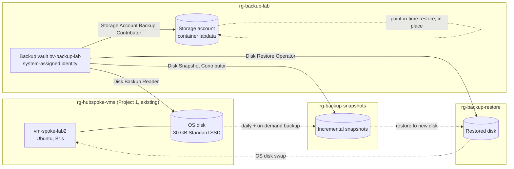
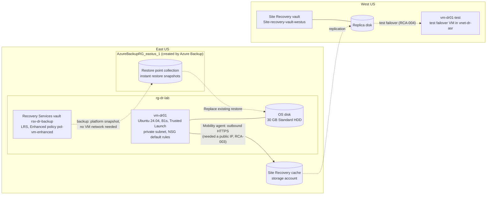

# Azure Backup and Recovery Lab

Backup **and proven restore** for two workloads: an Azure VM's OS disk (Azure Disk Backup, restored and swapped back in) and blob data (operational backup, point-in-time restore). **Lab 8** extends it to **Azure VM backup** in a Recovery Services vault and **Azure Site Recovery** replication to a second region, with a test failover ([Lab 8 section](#lab-8-azure-vm-backup-and-site-recovery)). Recovery objectives were defined before testing, data loss was simulated, every restore was verified by **SHA-256 checksum**, and recovery time was **measured**. Results, including two failures and their root causes, are reported as they happened.

Built as a hands-on project while studying for **AZ-104: Microsoft Azure Administrator**. This is lab work in a personal subscription, not a production environment.

> **Status:** Complete. Two vaults are waiting for soft delete to expire before they can be deleted:
> - the Backup vault `bv-backup-lab`, purge **2026-11-15 21:45 UTC** (see [Teardown](#teardown));
> - the Lab 8 Recovery Services vault `rsv-dr-backup` and one instant restore snapshot, purge about **2026-11-21 16:10 UTC** (see [Lab 8 teardown](#lab-8-teardown)).

## Results at a Glance

| Test | Data verified | RTO measured | Target | Result |
|---|---|---|---|---|
| Disk restore, attempt 1 | ❌ restored disk re-damaged on first boot | 10:38 | ≤ 30:00 | **FAIL**, see [RCA-001](docs/rca/rca-001-run-command-replay.md) |
| Disk restore, attempt 2 | ✅ both hashes match | **10:23** | ≤ 30:00 | **PASS** |
| Blob point-in-time restore | ✅ overwritten and deleted blobs restored, control blob unchanged | **26:27** | ≤ 15:00 | **FAIL**, see [RCA-002](docs/rca/rca-002-blob-rto-target.md) |
| Lab 8: VM restore, Replace existing | ✅ 3 of 3 hashes match | **27:37** (includes one refused attempt) | ≤ 30:00 | **PASS** |
| Lab 8: Site Recovery test failover | ✅ 3 of 3 hashes match in West US; RPO **not proven** | job 2:27 | — | **Partial**, see [RCA-004](docs/rca/rca-004-test-failover-stale-and-not-isolated.md) |

**RPO (Recovery Point Objective):** disk backups run daily, so the worst case is just under 24 h. In the test, the on-demand recovery point was 5½ minutes before the incident. Blob operational backup is continuous: any second inside the 7-day window can be restored.

## Business Problem

A backup is only proven by a **restore**. Teams often discover during an incident that a backup was incomplete, unrestorable, or far slower to restore than assumed. This lab tests that assumption end to end: define the objectives, back up, destroy data on purpose, restore, prove the data is the right data, and time it.

It completes the operations story across this portfolio: Project 2 (Azure Monitoring and Incident Response) detects incidents, Project 3 (Azure Bicep CI/CD Pipeline) prevents bad changes, and this project recovers when something is lost anyway.

## Architecture



| Resource group | Contents | Vault identity's role (least privilege) |
|---|---|---|
| `rg-backup-lab` | Backup vault, blob storage account | Storage Account Backup Contributor on **the storage account only** |
| `rg-hubspoke-vms` (Project 1) | Source VM and disk | Disk Backup Reader on **the one disk only** |
| `rg-backup-snapshots` | Snapshots taken by Disk Backup | Disk Snapshot Contributor on this RG |
| `rg-backup-restore` | Disks restored from recovery points | Disk Restore Operator on this RG |

These are the roles Microsoft documents for each operation ("Use only the role definitions provided in the documentation"). Nothing was assigned at subscription scope. My own account received **Storage Blob Data Contributor** on the storage account only, so uploads and downloads used Entra ID sign-in (`--auth-mode login`) and never account keys.

## Design Decisions

| Decision | Alternative | Why |
|---|---|---|
| **Backup vault**, operational tier (Disk Backup + operational blob backup) | VM backup in a Recovery Services vault | VM backup carries a $10/month protected-instance fee (Azure Retail Prices API, East US). The operational tier has no protected-instance fee and no vault storage charge; snapshots bill at standard rates. Target lab cost under $1. |
| Restore to a **new disk** and **swap the OS disk** | Restore in place | Disk Backup doesn't support original-location restore. Keeping the original disk detached also made rollback trivial. |
| Snapshots and restores in **separate resource groups** | Everything in one RG | The vault's identity gets write access only where backups and restores land, and the budget can filter by RG. |
| Budget filtered by **resource group** | Filter by tag | Snapshots created by Azure Backup don't inherit our tags. |
| Vault and policies **built in the portal, then codified** in Bicep from exported state | Bicep first | Learn the settings, then prove the code matches what Azure stores: `what-if` reported **3 no change** ([m1-04](docs/evidence/m1-04-vault-bicep-whatif.txt)). |
| Blob policy created from an **explicit operational-only definition** | Portal or default template | The portal wouldn't allow unchecking the paid vaulted tier, and the CLI default template is vaulted too ([m1-02](docs/evidence/m1-02-backup-policies.txt)). |
| Verification by **SHA-256** of known data with a random nonce | "Job succeeded" | A completed job proves nothing about the data. Attempt 1 is the proof: the job succeeded, and the data was wrong. |

## Repository Structure

```
.
├── infra/
│   ├── budget.bicep                   # $5 monthly budget on the lab RGs (subscription scope)
│   ├── budget.example.bicepparam      # copy to budget.local.bicepparam (gitignored) with your email
│   ├── vault.bicep                    # Backup vault + disk and blob policies
│   └── lab8/
│       └── recovery-vault.bicep       # Lab 8: Recovery Services vault + Enhanced VM policy
├── docs/
│   ├── plan.md                        # approved plan, milestones, cost, safety, outcomes (incl. Lab 8)
│   ├── evidence/                      # sanitized command output (m0-01 ... m5-02, lab8-00 ... lab8-07)
│   ├── rca/
│   │   ├── rca-001-run-command-replay.md
│   │   ├── rca-002-blob-rto-target.md
│   │   ├── rca-003-asr-registration-private-subnet.md
│   │   └── rca-004-test-failover-stale-and-not-isolated.md
│   └── interview-guide.md
├── bicepconfig.json                   # linter rules raised to errors
└── .gitignore                         # excludes *.local.bicepparam, infra/export/, testdata/
```

## Prerequisites

- An Azure subscription where you can create resources and role assignments (Owner, or Contributor + User Access Administrator)
- Azure CLI with the `dataprotection` extension (tested with CLI 2.90.0 and extension 1.14.0), Bicep 0.48+, PowerShell 7
- An existing Linux VM to protect. This lab used Project 1's `vm-spoke-lab2`.

## How to Reproduce

1. **Resource groups and budget** (M0)
   ```powershell
   az group create -n rg-backup-lab -l eastus
   az group create -n rg-backup-snapshots -l eastus
   az group create -n rg-backup-restore -l eastus
   Copy-Item infra\budget.example.bicepparam infra\budget.local.bicepparam   # then set your email
   az deployment sub what-if -l eastus -f infra\budget.bicep -p infra\budget.local.bicepparam
   az deployment sub create  -l eastus -f infra\budget.bicep -p infra\budget.local.bicepparam
   ```
2. **Vault and policies** (M1): `az deployment group create -g rg-backup-lab -f infra\vault.bicep`
3. **Vault identity roles** (M1): assign the three disk roles at the scopes in the architecture table, using `--assignee-object-id` with `--assignee-principal-type ServicePrincipal`. Result: [m1-03](docs/evidence/m1-03-vault-identity-roles.txt).
4. **Disk backup** (M2): write test data and record its hashes, deallocate the VM, configure backup with `pol-disk-daily` and snapshot RG `rg-backup-snapshots`, then **Backup now** ([m2-01](docs/evidence/m2-01-marker-baseline.txt), [m2-02](docs/evidence/m2-02-disk-backup.txt)).
5. **Disk restore** (M3): restore the recovery point to a new disk in `rg-backup-restore`, run `az vm update --os-disk <restored disk id>`, start the VM, and verify the hashes. **Read [RCA-001](docs/rca/rca-001-run-command-replay.md) first.**
6. **Blob backup and restore** (M4): create a storage account with hierarchical namespace **off**, assign the storage role to the vault and a data role to yourself, configure backup with `pol-blob-operational`, then run a point-in-time restore ([m4-01](docs/evidence/m4-01-storage-and-roles.txt) to [m4-04](docs/evidence/m4-04-incident-restore.txt)).

## Security

- **Least privilege:** four narrow roles for the vault identity, each at a single resource or lab RG, verified by listing every assignment it held ([m1-03](docs/evidence/m1-03-vault-identity-roles.txt), [m5-01](docs/evidence/m5-01-pre-teardown-inventory.txt)).
- **No keys:** all blob data access used Entra ID and the Storage Blob Data Contributor role. Being subscription Owner (control plane) doesn't grant blob data access (data plane).
- **Storage account:** TLS 1.2 minimum, HTTPS only, anonymous access off, cross-tenant replication off, Entra ID authorization as the portal default.
- **Vault:** soft delete on (14 days). Immutability and always-on soft delete were deliberately **off** so the lab could be torn down. Azure scores this `bcdrSecurityLevel: Poor`; in production you'd enable both and add a Resource Guard.
- **Secrets:** the budget email lives in a gitignored `*.local.bicepparam` and is `@secure()`. Evidence is sanitized for subscription IDs, GUIDs, and email addresses before each commit.

## Testing and Evidence

Every milestone has sanitized evidence in [`docs/evidence/`](docs/evidence/):

| Milestone | Evidence | What it proves |
|---|---|---|
| M0 Budget | `m0-01` to `m0-03` | Budget deployed by Bicep; drift check clean except the `@secure()` email |
| M1 Vault | `m1-01` to `m1-04` | Vault settings, policies, exact role scopes, Bicep what-if **3 no change** |
| M2 Disk backup | `m2-01`, `m2-02` | Baseline hashes; backup job 3:37; recovery point taken after the baseline |
| M3 Disk restore | `m3-01` to `m3-03` | Attempt 1 FAIL and its forensic diagnosis; attempt 2 PASS with hash match |
| M4 Blob restore | `m4-01` to `m4-04` | Backup's changes to the account; PITR restore; hash match; RTO miss |
| M5 Teardown | `m5-01`, `m5-02` | Inventory before deletion; every deletion and its verification |

### RTO breakdowns

| Disk, attempt 2 | Time |
|---|---|
| Restore (portal + job) | 6:32 |
| OS disk swap | 0:34 |
| VM start | 1:13 |
| Agent settle wait (90 s safeguard, see RCA-001) + verify | 2:05 |
| **Total** | **10:23** |

| Blob PITR | Time |
|---|---|
| Detection to restore job start (portal navigation) | 10:31 |
| Restore job | 15:22 |
| Download and verify | 0:34 |
| **Total** | **26:27** |

## Troubleshooting Cases

1. **[RCA-001](docs/rca/rca-001-run-command-replay.md): the restored disk came back already damaged.** The backup and restore were correct. Run Command (v1) replayed the destructive test script on the restored disk's first boot, because the disk's agent state was older than the VM's latest Run Command. Diagnosed from the disk's own boot history and agent folders, predicted for the retry, and observed three times.
2. **[RCA-002](docs/rca/rca-002-blob-rto-target.md): blob RTO target missed.** The 15-minute target was set without checking documented service behavior. Microsoft documents that a PITR job can take up to an hour even for a few changes.
3. **[RCA-003](docs/rca/rca-003-asr-registration-private-subnet.md): Site Recovery couldn't register the VM from a private subnet** (Lab 8). Backup worked from the same subnet, because the platform takes the snapshot. Site Recovery's agent runs in the guest and needs outbound HTTPS. I predicted the failure, then traced it from ARM error `151192` to the agent log (`registermachine`, error `20507`, 5-minute timeouts). A public IP fixed it, which confirmed the cause.
4. **[RCA-004](docs/rca/rca-004-test-failover-stale-and-not-isolated.md): the test failover ran on old data and wasn't isolated** (Lab 8). Auto-shutdown paused replication overnight. The drill was started before replication caught up, and it used the default target VNet, which has internet access. The data matched, but the RPO wasn't proven.
5. **Smaller findings** (recorded in the evidence notes):
   - The portal budget filter can't select empty resource groups; Bicep accepts their names.
   - What-if flagged date-only strings against stored ISO timestamps; declaring exactly what Azure stores fixed it.
   - The vault API rejected turning soft delete **Off** (`DppAlwaysOnSoftDeleteStateMandatory`): the current API version only accepts Always-On.
   - On Windows, `az` is a `.cmd` file, so a JMESPath such as `length(@)` gets misparsed by `cmd.exe`. Counting in PowerShell avoids it.
   - The `az` client crashed (`0xC0000005`) on several commands that succeeded anyway; state checks, not exit codes, confirmed the outcome.

## Cost

| Item | Basis |
|---|---|
| Vault, Disk Backup, operational blob backup | No protected-instance fee, no vault storage charge |
| 3 incremental snapshots, about 2 days | Billed on used GB at Standard HDD rates |
| 2 restored 30 GB disks, about 2 days | Standard SSD, hourly |
| Storage account (about 1 MB) and the PITR restore | Fractions of a cent |
| VM runtime | Under an hour in total, billed in Project 1's RG |

The target was under $1 with a $5 budget cap. The final figure is pending: Cost Management data lags 24–72 h, so it will be checked before the budget is deleted.

## Teardown

Order matters. The backup lock blocks deleting the storage account, soft delete blocks deleting the vault, and snapshots aren't removed with the backup instance.

1. Delete the backup instances. Azure Backup removed its own storage delete lock when blob protection stopped.
2. Remove the storage roles, then delete the storage account.
3. Delete the snapshots explicitly (they survived the instance deletion) and the restored disks.
4. Remove the vault identity's disk roles before deleting the vault, so nothing is left as an "Unknown" principal.
5. Delete the empty snapshot and restore resource groups.
6. **After 2026-11-15 21:45 UTC:** delete the policies, the vault, and `rg-backup-lab`; delete the budget after the final cost check.

The disk instance was soft-deleted for 14 days. The blob instance wasn't, because operational blob backup keeps no data in the vault. Full record: [m5-02](docs/evidence/m5-02-teardown.txt).

## Limitations

- **Same region, same subscription.** Operational-tier backups are snapshots. They protect against deletion, corruption, and bad changes, but not against losing the region or the subscription. Snapshots in the operational store are zone-redundant, which covers the loss of one zone.
- **One VM, one storage account, a few MB of data.** Restore times at scale will differ; Microsoft documents PITR time scaling with the number of changes.
- **The storage account allowed public network access**, gated by Entra ID and RBAC. Production would use selected networks or a private endpoint.
- **Shared-key access was left enabled** but never used. Disabling it is a production hardening step.
- **Restores were run from the portal**, which cost about 10 minutes of the blob RTO.
- **Role assignments aren't in Bicep.** They were created with the CLI; declaring them in Bicep would have generated different names and collided.
- **The disk policy schedule uses a fixed UTC−5 offset** ("Eastern Standard Time"), so the local run time shifts by an hour across daylight saving.

## Improvements for Production

- Script restores with the CLI (`az dataprotection backup-instance restore`) instead of clicking through the portal.
- Set RTO targets from documented and measured behavior: about 1 hour for PITR. For single-object recovery, use blob soft-delete undelete or promote a previous version.
- Make Run Command and Custom Script Extension scripts idempotent, or use managed Run Commands, so a replay after a disk restore can't do harm (RCA-001).
- Vaulted backups with cross-region restore for regional resilience; immutability and a Resource Guard.
- Alerts on backup job failures (Azure Monitor, as in Project 2) and on recovery-point age.
- A private endpoint and disabled shared-key access for the storage account.

## Skills Demonstrated (AZ-104)

- **Monitor and maintain Azure resources:** Azure Backup (Backup vault, policies, on-demand backup, restore), recovery objectives, restore testing, backup jobs
- **Manage identities and governance:** managed identities, built-in role selection, scope-level least privilege, control plane versus data plane, resource locks, budgets
- **Implement and manage storage:** blob versioning, change feed, soft delete, point-in-time restore, storage security settings
- **Deploy and manage compute:** managed disks, snapshots, OS disk swap, Run Command
- **Infrastructure as code:** Bicep with linting, what-if drift checks, exporting and codifying existing resources
- **Lab 8, business continuity:**
  - Recovery Services vault and Enhanced VM backup policy (Trusted Launch)
  - instant restore, Replace existing restore
  - secure-by-default soft delete
  - Azure Site Recovery replication and test failover
  - in-guest versus platform network dependencies

## Lab 8: Azure VM Backup and Site Recovery

Added 2026-11-07 to 2026-11-08 to cover the two services the original design declined on cost:
- **Azure VM backup** in a Recovery Services vault;
- **Azure Site Recovery** (ASR) replication to a second region.

It was kept cheap:
- one B1s VM with a Standard HDD disk;
- backup protection stopped the same day;
- replication torn down right after the drill.

Every test had predictions recorded first ([lab8-01](docs/evidence/lab8-01-build.txt) to [lab8-05](docs/evidence/lab8-05-test-failover.txt)).

### Lab 8 results

| Test | Result | Measured |
|---|---|---|
| VM backup, Enhanced policy, VM with **no outbound internet** | ✅ Completed | Job 27:18. Snapshot 8:11; the instant restore point existed before the vault transfer finished. |
| Change vault redundancy after protecting the VM | ✅ Refused as predicted (`StorageModelModifyError`) | — |
| Restore, Replace existing, attempt 1 | ❌ Refused: `UserErrorVmNotShutDown` (VM must be deallocated) | — |
| Restore, Replace existing, attempt 2 | ✅ 3 of 3 hashes match the baseline | RTO **27:37** against 30:00 |
| Enable replication from the private subnet | ❌ `151192` / agent `20507` ([RCA-003](docs/rca/rca-003-asr-registration-private-subnet.md)) | Failed after about 33 min |
| Enable replication with outbound HTTPS | ✅ Protected, health Normal | About 35 min |
| Test failover to West US | ✅ 3 of 3 hashes match; ⚠️ RPO not proven; ⚠️ not isolated ([RCA-004](docs/rca/rca-004-test-failover-stale-and-not-isolated.md)) | Job 2:27 |
| Vault as code (Bicep what-if) | ✅ NoChange on vault and policy, after one fix | — |

### Lab 8 architecture



### Lab 8 design decisions

| Decision | Alternative | Why |
|---|---|---|
| Recovery Services vault, **LRS**, cross-region restore off | GRS with cross-region restore | Cheapest. Redundancy locks after the first protected item, and the lab proved it (portal greyed out, `StorageModelModifyError`). |
| **Enhanced policy** (V2): daily at 22:00 Eastern, 7-day retention, 1-day instant restore | Standard policy | The VM uses Trusted Launch (portal default), which the portal protects only with the Enhanced policy. Minimum retention keeps storage low. |
| **Private subnet** (`defaultOutboundAccess: false`), no public IP | Default outbound access | Shows which services need the VM's network. Backup didn't; Site Recovery did. |
| Standard **public IP** for Site Recovery outbound; NSG kept at default rules (inbound denied) | NAT gateway | The lab's cost policy blocks NAT gateways, and a public IP is $0.005/h. Lab pattern only; production would use NAT gateway, a firewall, or service-tag NSG rules. |
| Backup protection **stopped the same day** | Keep protecting | The VM protected-instance fee is $10/month and billed pro rata. Soft-deleted data has no charge. |
| ASR default policy and vault resource group | Custom policy and resource group | The VM blade only offered the defaults. Recorded as a deviation; replication was disabled after the drill. |
| Built in the portal, then **codified** in [`infra/lab8/recovery-vault.bicep`](infra/lab8/recovery-vault.bicep) from exported state | Bicep first | What-if first showed two `Delete` lines on the policy. Azure stores `duration: 0` and `durationType: Invalid` for "no archive tier", and the template hadn't declared them. After declaring them: **NoChange=2** ([lab8-07](docs/evidence/lab8-07-bicep-whatif.txt)). |

### Lab 8 evidence

| File | What it proves |
|---|---|
| [lab8-00](docs/evidence/lab8-00-preflight.txt) | Providers, inventory, quotas, policy (NAT gateway blocked), retail prices |
| [lab8-01](docs/evidence/lab8-01-build.txt) | Private subnet, no outbound (`curl 000`), baseline SHA-256 hashes |
| [lab8-02](docs/evidence/lab8-02-backup.txt) | Vault settings, refused redundancy change, backup job timings, AlwaysON soft delete |
| [lab8-03](docs/evidence/lab8-03-restore.txt) | Incident, refused and successful restore, hash match, RTO, Run Command replay |
| [lab8-04](docs/evidence/lab8-04-asr.txt) | Replication failure diagnosis (ARM, ASR jobs, agent logs), fix, retry |
| [lab8-05](docs/evidence/lab8-05-test-failover.txt) | Health diagnosis, test failover, data check, process deviation |
| [lab8-06](docs/evidence/lab8-06-teardown.txt) | Teardown, corrections, blocked snapshot deletion |
| [lab8-07](docs/evidence/lab8-07-bicep-whatif.txt) | Bicep lint, what-if drift check, fix, clean re-run |

### Lab 8 findings

- **Replace existing doesn't manage VM power.** The VM must be deallocated before the restore is accepted, and the job leaves it deallocated. Both steps belong in the runbook and in the RTO.
- **Run Command replay (RCA-001) was reproduced on purpose.** The restored disk re-ran the latest Run Command at first boot. Because the read-only command had been issued last, the replay was harmless.
- **Replace existing keeps the original OS disk** as an Unattached disk. It keeps billing until you delete it.
- **Soft delete is AlwaysON on a new Recovery Services vault** (secure by default). The vault can't be deleted until the soft-deleted item is purged, 14 days after protection stops.
- **The instant restore snapshot outlived its 1-day retention.** Deleting its resource group failed with `ResourceDeletionFailed`, with no further detail. Microsoft documents that recovery points of a soft-deleted item aren't cleaned up on expiry, so the soft-delete hold is the likely cause. That is **inferred**, not confirmed by the error.
- **Disable replication left the Site Recovery extensions on the VM**; my prediction K3 was wrong. ASR also left a disk `ms-asr-<id>` in the source resource group; its purpose is unconfirmed, and it was deleted.
- **The target VNet created by ASR didn't copy the private-subnet setting**: default outbound access was on.
- **Windows `az` is a `.cmd` file.** An `&` in an `az rest` URL ends the command, so pass query parameters with `--uri-parameters` instead.

### Lab 8 cost

| Item | Basis (Azure Retail Prices API, East US / West US) | Estimate |
|---|---|---|
| VM backup protected instance | $10/month, protection stopped after about a day | ~$0.35 |
| Vault storage (LRS) | $0.0224/GB-month, a few GB for a day | < $0.01 |
| VM runtime | B1s $0.0104/h, about 10 h (auto-shutdown at 19:00) | ~$0.10 |
| Test failover VM | B1s West US $0.0124/h, under 30 min | < $0.01 |
| Public IP | $0.005/h, about 26 h | ~$0.13 |
| Disks, replica disk, cache account | 30 GB Standard HDD, about a day each | ~$0.15 |
| Site Recovery | $25/month per VM, but the first 31 days per instance are free | $0 |
| Instant restore snapshot | Incremental, held until the purge date | Cents |
| **Total** | | **Estimate under $1. Actual to be confirmed in Cost Management.** |

### Lab 8 teardown

Done 2026-11-08 ([lab8-06](docs/evidence/lab8-06-teardown.txt)):
1. Cleaned up the test failover and disabled replication.
2. Deleted both Site Recovery resource groups.
3. Deleted the VM, its disks (including `ms-asr-<id>`), public IP, VNet, NSG and SSH key resource.
4. Removed the downloaded private key from the PC.

Still to do, **after 2026-11-21 16:10 UTC**, when the soft-deleted backup item is purged:
1. Confirm the item is gone.
2. Check the restore point collection in `AzureBackupRG_eastus_1`. Delete it if Azure Backup hasn't, then delete that resource group.
3. Delete `rsv-dr-backup` and `rg-dr-lab`.

**Lesson:** deleting a resource group doesn't override a hold on what's inside it. ARM tries to delete each resource and rolls the group back if one fails.

### Lab 8 limitations

- **The drill didn't prove the RPO.** The marker test was skipped, and the recovery point was most likely about 19 hours old ([RCA-004](docs/rca/rca-004-test-failover-stale-and-not-isolated.md)).
- **No real failover or failback**, only a test failover. A planned or unplanned failover would also exercise re-protect and failback.
- **The outbound path was a public IP on the VM.** That's acceptable in a lab with inbound denied, not as a production pattern.
- **Crash-consistent only.** No app-consistent recovery points (warning `153006`); a single VM with no application.
- **The vault is in Bicep, but the VM, network and replication aren't.** They were built in the portal for practice.
